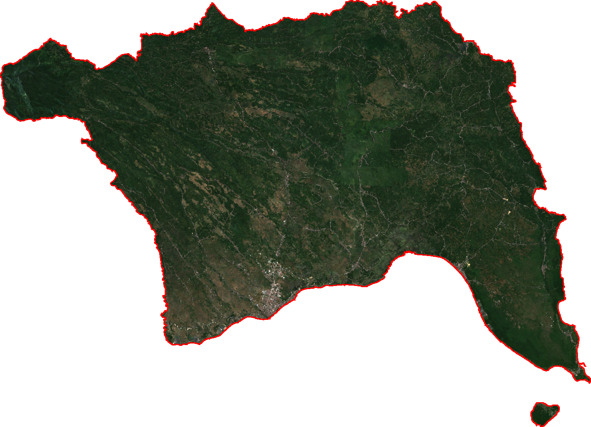
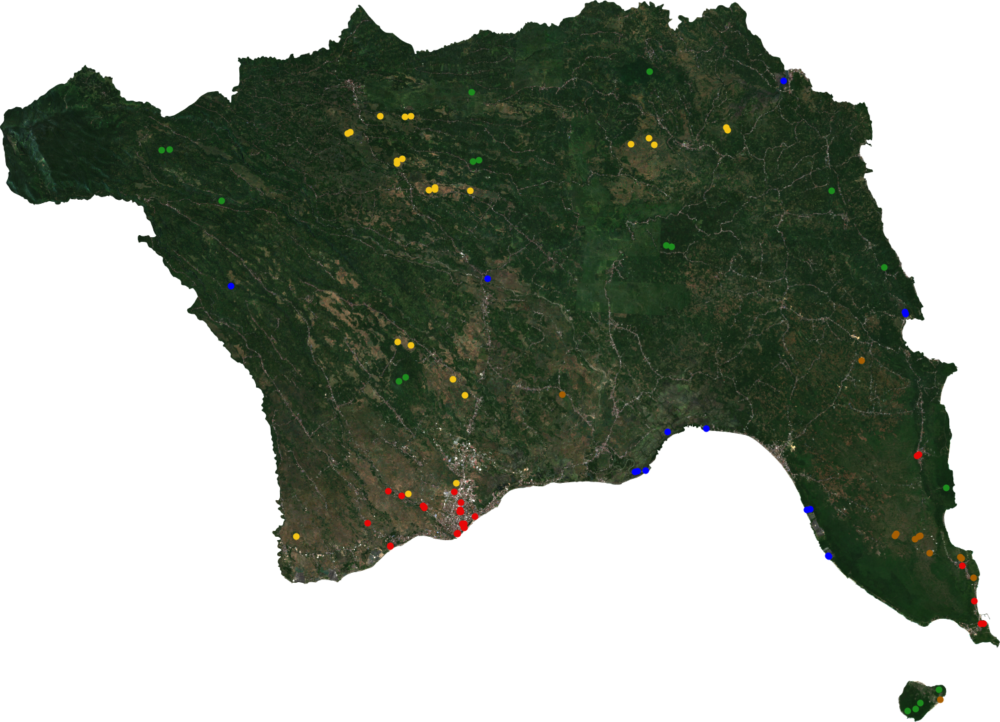
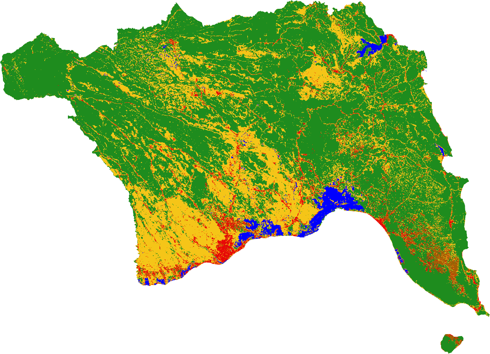

# Klasifikasi Penutup Lahan Menggunakan Random Forest di Google Earth Engine
## 1. Identitas

| | |
|---|---|
| **Judul** | Klasifikasi Penutup Lahan Menggunakan Random Forest di Google Earth Engine: Kabupaten Bulukumba, Sulawesi Selatan |
| **Nama** | ASHABUL KAHFI |
| **NIM** | V126241005 |
| **Mata Kuliah** | Praktek Pemrograman Spasial |

## 2. Tautan Penting

- **Script Google Earth Engine:** https://code.earthengine.google.com/c180600e0d79d8d4c22024909e217d32
- **Salinan script di repository ini:** [`script/LandCover_RF.js`](script/LandCover_RF.js)
- **Asset sampel (titik latih, validasi, dan uji):** https://code.earthengine.google.com/?asset=projects/petakepintaran/assets/SampleRFBulukumba

## 3. Latar Belakang

Informasi penutup lahan menunjukkan apa yang menutupi permukaan bumi, misalnya vegetasi, sawah, badan air, lahan terbuka, dan lahan terbangun. Informasi ini dipakai dalam perencanaan tata ruang, pemantauan perubahan lahan, pengelolaan sumber daya air, dan pemantauan lahan pertanian. Karena kondisi lahan terus berubah, peta penutup lahan perlu diperbarui secara berkala dengan cara yang cepat dan murah.

Kabupaten Bulukumba di Sulawesi Selatan dipilih sebagai lokasi kajian karena memiliki tutupan lahan yang beragam dalam satu wilayah, yaitu kawasan hutan dan pegunungan, hamparan sawah, kawasan perkotaan di sekitar Kota Bulukumba, serta wilayah pesisir. Keragaman ini cocok untuk menguji kemampuan klasifikasi dalam membedakan beberapa kelas penutup lahan sekaligus. Informasi penutup lahan di wilayah seperti ini penting untuk perencanaan tata ruang, pemantauan lahan pertanian (sawah), pengelolaan kawasan hutan, dan pemantauan perkembangan kawasan terbangun di sekitar kota dan pesisir.

Penginderaan jauh membantu pemetaan penutup lahan di wilayah yang luas. Citra Sentinel-2 tersedia gratis dengan resolusi spasial 10 sampai 20 meter dan beberapa band yang peka terhadap vegetasi, air, dan tanah. Google Earth Engine (GEE) memungkinkan pengolahan banyak citra tanpa mengunduhnya. Algoritma Random Forest dipilih karena umum dipakai untuk klasifikasi penutup lahan, mampu memakai banyak variabel prediktor sekaligus, dan memberi informasi tentang prediktor yang paling berpengaruh.

## 4. Tujuan

1. Memetakan penutup lahan di Kabupaten Bulukumba, Sulawesi Selatan ke dalam lima kelas, yaitu vegetasi, sawah, badan air, lahan terbuka, dan lahan terbangun, menggunakan citra Sentinel-2 dan algoritma Random Forest di Google Earth Engine.
2. Menilai akurasi hasil klasifikasi menggunakan data uji yang terpisah dari data latih.
3. Mengetahui prediktor yang paling berpengaruh terhadap hasil klasifikasi.

## 5. Area Kajian

- **Lokasi:** Kabupaten Bulukumba, Provinsi Sulawesi Selatan, mencakup Kota Bulukumba dan wilayah sekitarnya
- **Luas:** sekitar 118.066 hektar (dihitung dari batas area kajian di GEE)
- **Karakteristik lahan:** Area kajian memiliki tutupan lahan yang bervariasi, yaitu kawasan hutan dan pegunungan, hamparan sawah, permukiman dan kawasan perkotaan di sekitar Kota Bulukumba, serta wilayah pesisir dengan badan air. Perbedaan ketinggian dari pesisir, dataran rendah, hingga kawasan pegunungan membuat wilayah ini cocok untuk memetakan lima kelas penutup lahan.




## 6. Data dan Prediktor

### 6.1 Data yang digunakan

| Data | Sensor / Produk | Periode | Resolusi | Sumber |
|---|---|---|---|---|
| Citra optik | Sentinel-2 MSI Level-2A Surface Reflectance (`COPERNICUS/S2_SR_HARMONIZED`) | 1 Januari 2025 - 31 Desember 2025] | 10 m (B2, B3, B4, B8) dan 20 m (B11, B12) | ESA / Copernicus, diakses melalui GEE |
| Skor kualitas citra | Cloud Score+ (`GOOGLE/CLOUD_SCORE_PLUS/V1/S2_HARMONIZED`) | Mengikuti citra Sentinel-2 | 10 m | Google, diakses melalui GEE |
| Elevasi | SRTM (`USGS/SRTMGL1_003`) | 2000 | 30 m | USGS / NASA, diakses melalui GEE |
| Sampel referensi | Titik hasil interpretasi visual di QGIS dengan acuan citra Google Satellite |  | - | Dibuat sendiri |

### 6.2 Prediktor dan alasan pemilihannya

Total ada 12 prediktor.

| No | Prediktor | Jenis | Alasan pemilihan |
|---|---|---|---|
| 1 | B2 (Biru) | Band | Membantu membedakan tanah, bangunan, dan air dari vegetasi. |
| 2 | B3 (Hijau) | Band | Vegetasi memantulkan hijau lebih kuat dari biru dan merah. Dipakai juga untuk MNDWI. |
| 3 | B4 (Merah) | Band | Vegetasi menyerap merah, sedangkan tanah terbuka dan bangunan memantulkannya lebih kuat. |
| 4 | B8 (NIR) | Band | Vegetasi sehat memantulkan NIR sangat kuat, sedangkan air menyerapnya. |
| 5 | B11 (SWIR 1) | Band | Peka terhadap kadar air pada vegetasi dan tanah, serta membantu membedakan lahan terbangun dan lahan terbuka. |
| 6 | B12 (SWIR 2) | Band | Melengkapi B11 dalam membedakan tanah, bangunan, dan vegetasi. |
| 7 | NDVI | Indeks | Menonjolkan tingkat kehijauan vegetasi. Membantu memisahkan vegetasi dan sawah dari lahan non-vegetasi. |
| 8 | MNDWI | Indeks | Menonjolkan badan air. Kombinasi hijau dan SWIR menekan pengaruh bangunan dibanding NDWI biasa. |
| 9 | NDBI | Indeks | Menonjolkan area terbangun yang memantulkan SWIR lebih besar dari NIR. |
| 10 | BSI | Indeks | Menonjolkan tanah terbuka. |
| 11 | Elevasi | Topografi | Perbedaan ketinggian membantu memisahkan kelas yang spektralnya mirip, misalnya sawah di dataran rendah dan vegetasi di dataran yang lebih tinggi. |
| 12 | Slope (kemiringan lereng) | Topografi | Sawah dan lahan terbangun cenderung berada di lahan datar, sedangkan vegetasi lebat lebih sering di lereng. |

### 6.3 Pra-pemrosesan citra

1. **Filter citra:** koleksi Sentinel-2 dibatasi pada area kajian, periode yang ditentukan, dan persentase awan metadata kurang dari 50%. Citra yang lolos filter berjumlah **100 citra**.
2. **Masking awan:** setiap citra digabungkan dengan Cloud Score+, dan piksel dengan skor kejernihan (`cs_cdf`) di bawah **0,6** dibuang.
3. **Penskalaan:** nilai reflektansi dibagi 10.000 sehingga berada pada rentang 0-1.
4. **Komposit median:** seluruh citra digabung menjadi satu citra dengan nilai median per piksel. Median dipilih karena tidak mudah terpengaruh nilai ekstrem, misalnya sisa awan atau bayangan.
5. **Pemotongan (clip):** komposit dipotong sesuai batas area kajian.


## 7. Metode

### 7.1 Definisi kelas dan ciri visual

| ID | Kelas | Ciri visual pada citra |
|---|---|---|
| 1 | Vegetasi | Hijau tua, tekstur kasar atau bergelombang, mencakup hutan dan kebun di area perbukitan dan pegunungan |
| 2 | Sawah | Hijau muda atau cokelat keabuan tergantung fase tanam, berpetak teratur, di dataran rendah yang datar |
| 3 | Badan Air | Gelap (biru tua hingga kehitaman), permukaan halus, mencakup laut, sungai, dan badan air lainnya |
| 4 | Lahan Terbuka | Cokelat muda hingga putih keabuan, tanpa tutupan vegetasi dan tanpa bangunan, berupa tanah kosong atau lahan yang baru dibuka |
| 5 | Lahan Terbangun | Warna terang (putih, abu-abu, atau oranye kemerahan dari atap), bentuk persegi dan garis lurus, pola jalan dan permukiman, terutama di sekitar Kota Bulukumba |

### 7.2 Pengambilan sampel dan pembagian data

Sampel berupa titik yang dibuat di QGIS melalui interpretasi visual dengan acuan citra Google Satellite. Setiap titik diberi atribut `kelas`. Titik diletakkan di bagian tengah area yang seragam dan disebar di seluruh area kajian. Shapefile titik kemudian diunggah ke GEE sebagai asset.

Data dibagi secara acak (seed 42) menjadi tiga bagian:

- **Latih (60%):** untuk melatih model.
- **Validasi (20%):** untuk memilih kombinasi parameter terbaik pada tahap tuning.
- **Uji (20%):** untuk menghitung akurasi akhir. Data ini tidak dipakai pada pelatihan maupun tuning sehingga nilai akurasinya lebih jujur.

Jumlah sampel per kelas:

| Kelas | Latih | Validasi | Uji | Total |
|---|---|---|---|---|
| 1 Vegetasi | 61 | 21 | 18 | 100 |
| 2 Sawah | 65 | 31 | 24 | 120 |
| 3 Badan Air | 41 | 15 | 14 | 70 |
| 4 Lahan Terbuka | 16 | 7 | 12 | 35 |
| 5 Lahan Terbangun | 61 | 19 | 30 | 110 |
| **Total** | 244 | 93 | 98 | 435 |

Jumlah sampel tiap kelas tidak sama. Lahan terbuka memiliki sampel paling sedikit (35 titik), sehingga data uji kelas ini hanya 12 titik.





### 7.3 Parameter Random Forest

Random Forest adalah gabungan banyak pohon keputusan yang hasilnya diputuskan dengan voting. Dua parameter diuji dengan *grid search*, yaitu semua kombinasi dicoba dan dinilai dengan data validasi:

| Parameter | Fungsi | Nilai yang diuji |
|---|---|---|
| `numberOfTrees` | Jumlah pohon. Lebih banyak pohon membuat hasil lebih stabil tetapi komputasi lebih lama. | 50, 100, 200, 300 |
| `variablesPerSplit` | Jumlah prediktor yang dipertimbangkan pada tiap percabangan. Nilai yang lebih kecil membuat pohon lebih beragam. | 2, 4, 6, 8 |

Terdapat 4 × 4 = 16 kombinasi. Kombinasi terbaik adalah **50 pohon dan `variablesPerSplit` 6** dengan akurasi validasi **0,978 (97,8%)**. Model akhir dilatih ulang dengan parameter tersebut memakai gabungan data latih dan validasi, dengan `seed` 42 agar hasil dapat direproduksi.

### 7.4 Alur kerja singkat

```text
Area kajian → Filter Sentinel-2 → Masking awan (Cloud Score+) → Komposit median
   → Tambah prediktor (indeks + topografi) → Ambil nilai prediktor di titik sampel
   → Bagi data (latih / validasi / uji) → Tuning Random Forest (grid search)
   → Latih model akhir → Klasifikasi seluruh area → Uji akurasi → Hitung luas → Ekspor
```

## 8. Hasil

### 8.1 Peta klasifikasi




Berdasarkan luasnya, vegetasi mendominasi area kajian (65,30%), diikuti sawah (25,67%), lahan terbangun (4,96%), badan air (2,58%), dan lahan terbuka (1,49%). 

### 8.2 Feature importance


| Peringkat | Prediktor | Importance |
|---|---|---|
| 1 | B8 | 22,149 |
| 2 | NDVI | 21,489 |
| 3 | B11 | 19,302 |
| 4 | B12 | 18,563 |
| 5 | Elevasi | 15,516 |
| 6 | NDBI | 14,378 |
| 7 | MNDWI | 12,458 |
| 8 | BSI | 7,125 |
| 9 | B3 | 6,013 |
| 10 | B2 | 5,929 |
| 11 | Slope | 5,778 |
| 12 | B4 | 5,701 |

Prediktor yang paling berpengaruh adalah B8 (NIR), NDVI, dan B11 (SWIR 1), disusul B12 dan elevasi. Prediktor yang berkaitan dengan vegetasi dan kadar air (NIR, NDVI, SWIR) paling banyak dipakai model untuk memisahkan kelas. Nilai importance menunjukkan seberapa sering dan seberapa besar sebuah prediktor membantu memisahkan kelas pada pohon-pohon model. Nilai ini bukan bukti hubungan sebab-akibat dan bisa dipengaruhi oleh prediktor lain yang berkorelasi.

### 8.3 Akurasi


| Metrik | Nilai |
|---|---|
| Overall Accuracy | 0,898 (89,8%) |
| Kappa | 0,868 |

Confusion matrix dalam bentuk tabel (data uji, 98 titik):

| Sebenarnya \ Prediksi | Vegetasi | Sawah | Badan Air | Lahan Terbuka | Lahan Terbangun | Total |
|---|---|---|---|---|---|---|
| Vegetasi | **18** | 0 | 0 | 0 | 0 | 18 |
| Sawah | 0 | **20** | 2 | 0 | 2 | 24 |
| Badan Air | 0 | 1 | **13** | 0 | 0 | 14 |
| Lahan Terbuka | 0 | 1 | 0 | **9** | 2 | 12 |
| Lahan Terbangun | 1 | 0 | 0 | 1 | **28** | 30 |
| **Total** | 19 | 22 | 15 | 10 | 32 | 98 |

Dari 98 titik uji, 88 titik (angka tebal pada diagonal) diklasifikasikan dengan benar dan 10 titik salah.

| Kelas | Producer's Accuracy | User's Accuracy |
|---|---|---|
| 1 Vegetasi | 100,0% | 94,7% |
| 2 Sawah | 83,3% | 90,9% |
| 3 Badan Air | 92,9% | 86,7% |
| 4 Lahan Terbuka | 75,0% | 90,0% |
| 5 Lahan Terbangun | 93,3% | 87,5% |

- **Overall Accuracy** adalah proporsi seluruh titik uji yang diklasifikasikan dengan benar.
- **Kappa** adalah ukuran kesesuaian setelah memperhitungkan tebakan benar yang terjadi secara kebetulan. Nilai di atas 0,8 umumnya dianggap kesesuaian yang kuat.
- **Producer's Accuracy** menunjukkan seberapa banyak titik sebenarnya suatu kelas yang berhasil dikenali (berkaitan dengan *omission error*).
- **User's Accuracy** menunjukkan seberapa besar peluang piksel yang dipetakan sebagai suatu kelas memang benar kelas tersebut (berkaitan dengan *commission error*).

### 8.4 Luas tiap kelas

| Kelas | Luas (ha) | Persentase |
|---|---|---|
| 1 Vegetasi | 76.611,07 | 65,30% |
| 2 Sawah | 30.114,46 | 25,67% |
| 3 Badan Air | 3.023,97 | 2,58% |
| 4 Lahan Terbuka | 1.753,58 | 1,49% |
| 5 Lahan Terbangun | 5.813,72 | 4,96% |
| **Total** | 117.316,80 | 100% |

Persentase dihitung terhadap total luas hasil klasifikasi. Total ini lebih kecil sekitar 749,6 ha (0,63%) dari luas area kajian (118.066,41 ha). Selisih tersebut kemungkinan berasal dari piksel yang tidak memiliki data (termask) pada komposit atau perbedaan perhitungan luas di tepi area kajian.

## 9. Pembahasan

### 9.1 Akurasi tertinggi dan terendah

Kelas **vegetasi** memiliki akurasi tertinggi (PA 100%, UA 94,7%), dengan seluruh 18 titik uji vegetasi dikenali dengan benar. Kelas **lahan terbangun** (PA 93,3%, UA 87,5%) dan **badan air** (PA 92,9%, UA 86,7%) juga tinggi. Kelas **lahan terbuka** memiliki Producer's Accuracy terendah (75,0%, dengan UA 90,0%), diikuti **sawah** (PA 83,3%, UA 90,9%).

Vegetasi mudah dikenali karena nilai NIR dan NDVI-nya khas dan jumlah sampelnya besar (100 titik). Rendahnya PA lahan terbuka kemungkinan dipengaruhi oleh jumlah sampelnya yang paling sedikit (35 titik) dan ciri spektralnya yang beragam, karena warna dan kelembapan tanah berbeda-beda. Perlu diingat bahwa data uji lahan terbuka hanya 12 titik, sehingga satu titik yang salah menurunkan PA kelas ini sekitar 8 poin persentase. Nilai akurasi kelas ini karena itu kurang stabil dan perlu ditafsirkan hati-hati.

### 9.2 Kelas yang sering tertukar

Dari 10 titik uji yang salah diklasifikasikan, pola kesalahannya sebagai berikut:

- **Lahan terbuka dan lahan terbangun (3 titik):** 2 titik lahan terbuka terklasifikasi sebagai lahan terbangun dan 1 titik lahan terbangun terklasifikasi sebagai lahan terbuka. Keduanya memantulkan SWIR dan merah cukup tinggi, dan atap, jalan, serta tanah kosong dapat memiliki nilai spektral yang mirip. Piksel 10-20 meter juga sering berisi campuran bangunan, tanah, dan pohon (*mixed pixel*).
- **Sawah terklasifikasi sebagai badan air (2 titik) dan lahan terbangun (2 titik):** kemungkinan karena sawah yang sedang tergenang pada fase pengolahan lahan atau tanam tampak seperti air, sedangkan sawah yang kering atau bera setelah panen dapat menyerupai tanah atau bangunan. Piksel di tepi sawah yang bercampur dengan permukiman juga bisa menjadi penyebab.
- **Kesalahan lain (3 titik):** 1 titik badan air menjadi sawah, 1 titik lahan terbuka menjadi sawah, dan 1 titik lahan terbangun menjadi vegetasi.

Tidak ada titik uji vegetasi dan sawah yang saling tertukar. Penyebab di atas adalah dugaan berdasarkan sifat spektral kelas. Untuk memastikannya, periksa lokasi titik-titik yang salah pada citra dan peta klasifikasi.

### 9.3 Pengaruh prediktor

Dari feature importance, B8, NDVI, dan B11 paling berpengaruh. Ini sesuai dengan kelas yang dipetakan, karena NIR dan NDVI memisahkan vegetasi atau sawah dari non-vegetasi, sedangkan SWIR membantu memisahkan lahan terbuka, lahan terbangun, dan air. Elevasi berada di peringkat kelima. Ini masuk akal karena wilayah kajian mencakup pesisir, dataran rendah (sawah dan permukiman), hingga hutan dan pegunungan yang lebih tinggi, sehingga ketinggian membantu memisahkan kelas. Slope berada di peringkat bawah, kemungkinan karena informasi ketinggian sudah cukup membantu memisahkan kelas-kelas tersebut. BSI dan band tampak (B2, B3, B4) berkontribusi lebih kecil, mungkin karena informasinya sudah tercakup oleh prediktor lain yang berkorelasi.

### 9.4 Keterbatasan dan saran perbaikan

- **Jumlah sampel tidak seimbang:** lahan terbuka hanya memiliki 35 titik (16 latih, 7 validasi, 12 uji), jauh di bawah kelas lain (70-120 titik) dan di bawah pedoman sekitar 100 titik per kelas. Model memiliki sedikit contoh untuk dipelajari dan PA kelas ini tidak stabil. *Saran:* tambah titik lahan terbuka dan badan air dari berbagai lokasi.
- **Perbedaan akurasi validasi dan uji:** akurasi validasi tertinggi pada tuning adalah 97,8% (93 titik), sedangkan akurasi uji 89,8% (98 titik). Akurasi validasi cenderung lebih optimis karena data tersebut dipakai untuk memilih parameter, sehingga akurasi uji lebih layak dijadikan ukuran kinerja model. Dengan data validasi sekecil itu, perbedaan akurasi antar kombinasi parameter juga belum tentu bermakna.
- **Awan dan komposit:** masking awan mengurangi gangguan, tetapi komposit median menggabungkan pengamatan dari tanggal berbeda. Perubahan musim, misalnya fase tanam sawah, bisa ikut tercampur. *Saran:* buat komposit per musim atau periode yang lebih pendek.
- **Sampel:** sampel dibuat lewat interpretasi visual dengan citra Google Satellite yang tanggal perekamannya bisa berbeda dari citra Sentinel-2, sehingga ada kemungkinan label yang tidak sesuai kondisi. Jumlah sampel uji per kelas juga terbatas. *Saran:* tambah sampel, validasi lapangan, dan pilih titik di area yang tidak berubah.
- **Pembagian data:** data dibagi secara acak per titik, sehingga titik latih dan uji yang berdekatan bisa punya karakteristik mirip dan akurasinya terlihat lebih tinggi dari kenyataan. *Saran:* gunakan pembagian secara spasial atau sampel uji independen yang dikumpulkan terpisah.
- **Resolusi:** piksel 10-20 meter dapat berisi campuran beberapa jenis tutupan, terutama di permukiman dan sawah berpetak kecil. *Saran:* tambahkan fitur tekstur atau gunakan citra resolusi lebih tinggi.
- **Akurasi pada titik uji:** titik uji diambil di lokasi yang jelas jenisnya, sedangkan peta mencakup juga area yang ambigu, sehingga akurasi peta secara keseluruhan bisa lebih rendah dari nilai OA.

## 10. Kesimpulan

Klasifikasi penutup lahan di Kabupaten Bulukumba, Sulawesi Selatan dengan citra Sentinel-2, 12 prediktor (band, indeks spektral, dan topografi), serta algoritma Random Forest di Google Earth Engine menghasilkan peta lima kelas dengan Overall Accuracy 89,8% dan Kappa 0,868 pada data uji yang terpisah. Prediktor yang paling berpengaruh adalah B8 (NIR), NDVI, dan B11 (SWIR 1).

Kelas vegetasi paling akurat dipetakan (PA 100%), sedangkan lahan terbuka paling rendah (PA 75%) dengan kesalahan utama berupa ketukaran dengan lahan terbangun. Sawah juga kadang terklasifikasi sebagai badan air atau lahan terbangun. Berdasarkan luasnya, vegetasi mendominasi area kajian (65,30%), diikuti sawah (25,67%). Akurasi dapat ditingkatkan dengan menambah sampel, terutama lahan terbuka, dan dengan membuat komposit per musim.

## 11. Cara Menjalankan Ulang

1. Buka [Google Earth Engine Code Editor](https://code.earthengine.google.com/) dan masuk dengan akun Google yang sudah terdaftar di GEE.
2. Siapkan batas area kajian sebagai poligon bernama `aoi` (gambar langsung di peta, atau unggah sebagai asset).
3. Siapkan sampel titik dalam shapefile dengan kolom `kelas` berisi nama kelas: `vegetasi`, `sawah`, `badan air`, `lahan terbuka`, `lahan terbangun`. Unggah shapefile (zip) ke tab **Assets**, atau gunakan asset sampel milik repository ini: https://code.earthengine.google.com/?asset=projects/petakepintaran/assets/SampleRFBulukumba.
4. Salin isi [`script/klasifikasi_rf.js`](script/klasifikasi_rf.js) ke Code Editor, lalu ganti ID asset sampel pada bagian 4 dengan ID asset yang kamu pakai.
5. Atur periode citra (`tglMulai`, `tglAkhir`) bila perlu, lalu klik **Run**.
6. Hasil akurasi, feature importance, dan luas tiap kelas muncul di tab **Console**. Link unduhan gambar peta ada di bagian paling bawah Console.
7. Untuk menyimpan peta klasifikasi dan tabel luas ke Google Drive, buka tab **Tasks** lalu klik **Run** pada tiap tugas ekspor.

> Karena pembagian data memakai seed tetap (42) dan model memakai seed tetap, hasil akan sama selama data sampel, area kajian, dan periode citra tidak diubah. Hasil bisa sedikit berbeda jika koleksi citra Sentinel-2 diperbarui.

## 12. Referensi

**Data**

- Google Earth Engine. *Sentinel-2 MSI Level-2A Harmonized.* https://developers.google.com/earth-engine/datasets/catalog/COPERNICUS_S2_SR_HARMONIZED
- Google Earth Engine. *Cloud Score+ S2 Harmonized.* https://developers.google.com/earth-engine/datasets/catalog/GOOGLE_CLOUD_SCORE_PLUS_V1_S2_HARMONIZED
- Google Earth Engine. *SRTM Digital Elevation Data 30 m.* https://developers.google.com/earth-engine/datasets/catalog/USGS_SRTMGL1_003
- Google Earth Engine. *ee.Classifier.smileRandomForest.* https://developers.google.com/earth-engine/apidocs/ee-classifier-smilerandomforest

**Literatur**

- Breiman, L. (2001). Random Forests. *Machine Learning*, 45(1), 5-32.
- Gorelick, N., Hancher, M., Dixon, M., Ilyushchenko, S., Thau, D., & Moore, R. (2017). Google Earth Engine: Planetary-scale geospatial analysis for everyone. *Remote Sensing of Environment*, 202, 18-27.
- Rouse, J. W., Haas, R. H., Schell, J. A., & Deering, D. W. (1974). Monitoring vegetation systems in the Great Plains with ERTS. *Third ERTS Symposium, NASA SP-351*, 309-317.
- Xu, H. (2006). Modification of normalised difference water index (NDWI) to enhance open water features in remotely sensed imagery. *International Journal of Remote Sensing*, 27(14), 3025-3033.
- Zha, Y., Gao, J., & Ni, S. (2003). Use of normalized difference built-up index in automatically mapping urban areas from TM imagery. *International Journal of Remote Sensing*, 24(3), 583-594.
- Rikimaru, A., Roy, P. S., & Miyatake, S. (2002). Tropical forest cover density mapping. *Tropical Ecology*, 43(1), 39-47.
- Farr, T. G., et al. (2007). The Shuttle Radar Topography Mission. *Reviews of Geophysics*, 45, RG2004.
- Congalton, R. G., & Green, K. (2019). *Assessing the Accuracy of Remotely Sensed Data: Principles and Practices* (3rd ed.). CRC Press.
